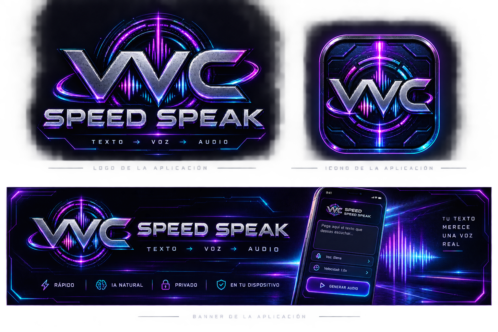

# 🚀 VVC SPEED SPEAK

> **Texto → Voz → Audio** | Lector de documentos inteligente, privado y 100% offline para Android.

  

---

## ✨ Características Principales

* **⚡ Rápido:** Procesamiento optimizado directamente en el dispositivo móvil.
* **🧠 IA Natural:** Integración con **KittenTTS** para una síntesis de voz fluida, humana y libre de tonos robóticos.
* **🔒 Privado:** Tus documentos y audios se procesan localmente sin enviar datos a la nube.
* **📱 100% Offline:** Funciona sin necesidad de conexión a internet una vez instalado.
* **📄 Lector de Documentos:** Compatible con la carga y lectura de archivos pesados en formatos **PDF** y **TXT**.

---

## 🎨 Identidad Visual y Estética

La aplicación cuenta con una interfaz de diseño futurista en modo oscuro, caracterizada por:
* Tonos de neón morado y azul eléctrico.
* Estética metálica y limpia.
* Controles multimedia intuitivos (Reproducir, Pausar, Detener y control de velocidad).

Los recursos oficiales de marca son:
* `assets/ic_launcher.png`: icono de aplicación para el sistema.
* `assets/logo.png`: logo horizontal mostrado dentro de la interfaz.
* `assets/branding.png`: composición de referencia de la identidad visual.

---

## 🛠️ Tecnologías Utilizadas

* **Python** como lenguaje base de desarrollo.
* **KittenTTS** (de KittenML) para la generación de voz local de alta calidad.
* **Kivy / Buildozer** para la estructura móvil y compilación en Android.
* **GitHub Actions** para la generación automática del archivo `.apk` en la nube.

---

## ⚙️ Compilación Automática (CI/CD)

Este proyecto está configurado para compilarse automáticamente mediante **GitHub Actions**. Cada vez que subas cambios al repositorio principal, la acción de compilación generará el archivo instalable de Android (`.apk`) listo para descargar desde la pestaña **Actions**.

---

## 📄 Licencia

Este proyecto se distribuye bajo los términos de la licencia de código abierto.
